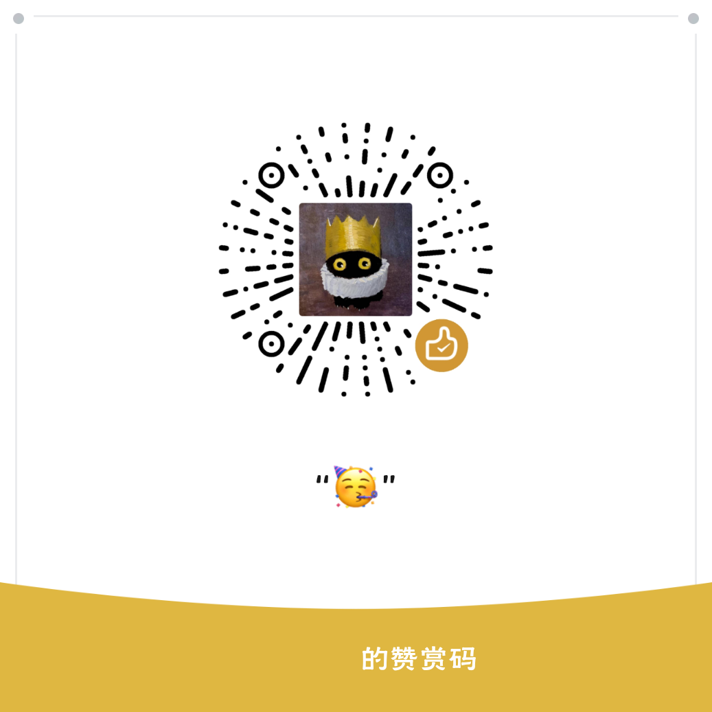

# 使用教程

> 本教程面向软件最新版本；旧版本的界面和功能可能有所不同。

> 交流反馈：QQ 频道 [MT阅读器](https://pd.qq.com/s/8yqstquyx?b=9)、QQ 群 **1080302768**、[Discord](https://discord.gg/qxfC2kqfr)

---

## 翻译主流程

### 1. 导入漫画

在漫画库页面操作：

- 点击右下角 **＋** 创建文件夹，进入后添加漫画图片
- 点击 **「从漫画文件夹导入」** 直接导入整个文件夹
  - 若目录下有多章子文件夹，会自动创建合集并导入为子章节
  - 若目录直接包含图片，按单本漫画导入
- 点击 **「从 CBZ/ZIP/PDF 导入」** 可直接导入压缩包或 PDF；导入时会显示进度提示
- **图片文件名需与阅读顺序一致**（如 `1.jpg`, `2.jpg`），否则页码会乱

### 2. 配置 API

软件需自备 API。如果还没有，先看：[API 获取指南](./API获取指南.md)。

> 提示：目标语言由软件界面语言决定。简体中文、繁体中文、英文、巴西葡萄牙语、俄文界面分别翻译为对应语言。

在设置页填写：

1. **API 格式** —— 按服务商接口选择「OpenAI 兼容」「OpenAI Responses」或「Gemini」
2. **API 地址** —— OpenAI 兼容接口填写服务商给出的上级地址即可，例如 `https://api.deepseek.com/v1`、`https://open.bigmodel.cn/api/paas/v4`；软件会自动补全 `/chat/completions`。OpenAI Responses 会补全 `/responses`；已填写完整端点时不会重复补全。两种 OpenAI 格式的「获取模型列表」会补全 `/models`
3. **API Key** —— 妥善保管，勿泄露
4. **模型名称** —— 须与供应商提供的完全一致，可直接从官网复制或点击「获取模型列表」选择

填写完成即返回漫画库。

### 3. 翻译

1. 在文件夹内设置源语言并点击 **「一键翻译」**（支持日/英/韩/法/西/葡/德/意/俄/中文等）；合集也可整体翻译
2. 等待翻译完成，或预处理结束后点击 **「开始阅读」** 边翻边看
3. 后台翻译完成后会发送带声音的高优先级通知，点击通知可回到漫画库查看结果

> 软件会自动判断作品是否更接近条漫并切换为「条漫滚动」；如需手动调整，可在文件夹的「阅读设置」中修改。
> 「全文速译」按最多 100 页的窗口依次完成 OCR、译名提取和翻译保存，再处理下一批，不必等全篇 OCR 完成。但首批仍需先提取译名，想更快开始阅读，可关闭全文速译，使用普通翻译。

### 4. 阅读与调整

- **拖动气泡** 可调整位置，软件会自动保存
- **双击图片** 进入/退出放大模式；进入放大后可使用 **取消键** 或 **加减号** 微调气泡
- **切换页面**：在漫画库文件夹中点击对应图片文件名即可跳转
- **单页或多页重译**：回到漫画库，长按图片进入多选，选中需要重译的页，再点击「重译所选」。全部重译可先「全选」，无需删除漫画
- **补缺文字区域**：右上角编辑按钮 → 加号新建空白气泡 → 拖到文字区域 → 绿勾退出；条漫模式下允许跨页创建气泡
- **全文速译太慢**：关闭「全文速译」即可改用逐页并发翻译
- **气泡太挡画面**：在设置的「普通气泡设置」中调整普通气泡或游离气泡的不透明度；悬浮窗气泡在「悬浮窗气泡设置」中单独调整
- **游离气泡文字色**：游离气泡会根据背景自适应文字颜色
- **翻译文风不佳**：在设置中调整全局翻译文风，或在文件夹内设置专属文风；合集内章节共用合集文风。「跟随全局文风」关闭后留空表示不附加文风要求
- **自定义字体**：在设置页的「字体设置」中可上传字体文件并开启加粗，普通气泡框与悬浮窗气泡框共用同一套字体

---

## 翻译方案的费用与效果

| 方案 | 请求内容与开支 | 效果与适用情况 |
| --- | --- | --- |
| 普通翻译：本地 OCR，关闭补充 | 本地识别后只发送文字，通常最省钱 | 适合字迹清晰、排版规整和内容简单的漫画；本地识别错字或漏字会影响译文 |
| 普通翻译 + AI OCR 补充 | 只有低置信度、识别不完整、为空或失败的区域额外发送裁剪图，再进行文字翻译；问题区域少且 OCR 模型便宜时，费用较低 | 在省钱与识别、翻译质量间取得平衡；不能保证发现所有识别错误 |
| 全文速译 + API OCR | 先按窗口完成 API OCR、译名提取和翻译；请求次数与图片识别费用较高 | 通常综合翻译质量最高的方案。API OCR 能减少本地识别错误，全文速译会统一前后人名、地名等译名；适合对成品质量要求最高的场景 |
| VL 整页直译 | 将标注后的页面或长图分块发给主视觉模型，跳过 OCR，通常比本地 OCR + 文字翻译更贵 | 理论上最快的方案，实际速度取决于所选 API 的响应速度、并发能力和图片处理速度；仍受检测范围和模型能力影响 |
| VL 整页直译 + 适度合并 | 一次发送多页及其分块，单次图片用量和费用更高，整体仍属于高预算方案 | 可减少请求次数并让模型参考相邻页对白，但实际速度仍取决于 API；合并过多可能漏译或降低质量 |

### 推荐起点

- **最省钱**：关闭全文速译和 VL 整页直译，使用本地 OCR，关闭 AI OCR 补充，主 API 选择便宜且翻译能力够用的文字模型。作品译名较少时也可关闭「译名处理」；已有译名仍会作为参考。
- **费用与质量均衡**：保留本地 OCR，将 AI OCR 补充从「低级」开始尝试，识别仍不理想再升到「中级」。OCR API 单独选择廉价、支持图片输入且擅长源语言识别的模型；主 API 继续负责翻译，不必让每次补充识别都使用昂贵主模型。
- **最高质量**：通常建议开启全文速译并关闭本地 OCR，改用质量较强的 API OCR，同时使用能力较强的主翻译模型。这样能兼顾 OCR 准确度和全文译名一致性，但请求次数与费用都会增加。
- **理论最快**：开启 VL 整页直译，使用响应速度快、并发能力强的视觉模型；实际速度取决于 API 服务商和网络状况，图片开支通常也更大。

### OCR 补充不建议使用按次收费的模型

OCR 补充按**识别区域**发起请求，不是每页固定一次。一页若有 8 个区域触发补充，就可能增加 8 次图片识别请求，之后还需文字翻译。中、高级会更积极地复核区域，因此请求数、耗时和费用可能明显增加。**优先选按用量计费的廉价视觉模型，并核对图片输入价格。** OCR API 目前只支持 OpenAI 兼容 chat 接口，模型必须支持图片输入，不能直接把纯文字模型用于补充识别。

### 合并页数翻译

- 适度合并有助于模型理解前后对白、统一称呼，也能减少请求次数及重复发送的提示词。按次收费的**翻译 API**可能因此省钱，但 OCR/API OCR 补充的请求数不受此设置影响。
- 合并上限为 100 页，建议 5～15 页；VL、长图或文字密集页宜从更小的批次尝试。过大的请求会增加手机负担和 AI 负担。

> 漏检的文字区域可手动画框补充翻译。

---

## 悬浮窗翻译

在漫画库页点击 **「悬浮窗翻译」**，按提示授予悬浮窗和屏幕捕获权限，并在启动时选择本次使用的翻译语言。悬浮球默认手势如下，可在「悬浮窗翻译设置」中为单击、双击、长按和三击重新指定操作：

| 操作 | 效果 |
|------|------|
| 单击悬浮球 | 识别并翻译当前屏幕文本 |
| 双击悬浮球 | 清除所有气泡 |
| 长按悬浮球 | 弹出菜单 |

长按菜单选项：

- **编辑模式**：悬浮层拦截触摸，可拖移气泡、长按删除、点击「新增气泡」后框选区域手动补框。确认后自动补翻新增气泡。
- **划屏翻译**：不自动检测，直接进入编辑模式由用户框选。
- **翻译检测区域**：在屏幕上框选翻译范围并确认，下次翻译生效；也可恢复全屏。
- **退出**：关闭悬浮窗。

编辑结果仅限当前会话，再次识别或退出后重置。遇到空画面或受截屏限制的应用时，软件会停止本次识别并提示；其他无识别结果的情况可检查屏幕捕获授权和 API 配置。

---

## 其它设置

### OCR 设置

在设置页点击「OCR 设置」：

- **开启本地 OCR**：使用内置引擎离线识别文字，后续 AI 翻译仍需联网；俄语需关闭本地 OCR 并配置 OCR API，或改用 VL 整页直译
- **AI OCR 补充模式**：开启本地 OCR 时，可按低/中/高级强度将识别不佳的整块区域交给 API 重新识别；关闭补充只用本地识别，中、高级会增加请求。费用与模型选择见上方说明
- **关闭本地 OCR**：全部使用在线 API OCR，需有可用的 OCR API 地址/Key/模型；每个字段留空时分别复用主 API 的对应配置
- API OCR 只支持 OpenAI 兼容 chat 接口，需使用支持图片输入及源语言识别的模型
- **手动框选气泡默认使用 API OCR**：独立于补充模式的开关，阅读页与悬浮窗共用；即使关闭补充，开启此项后手动补框仍会产生 OCR API 请求
- OCR 超时可调高「OCR API 超时（秒）」范围 30–1200

### 自定义请求参数

参数作用于主供应商，参数键不可重复。

### AI 请求设置

「每次请求合并页数」可设为 1–100，1 表示不合并，建议从 5～15 页尝试。文件夹、合集和批量任务中的普通翻译、全文速译及 VL 整页直译均支持合并，结果仍逐页保存；VL 合并发送多张独立图片。页数不是越大越好，费用与质量的取舍见上方说明。

### 文件夹翻译选项

- **VL 整页直译**：在文件夹内开启，使用支持图像输入的主模型翻译标注后的整页内容，跳过 OCR；长图按分块处理。它与「全文速译」不能同时开启。
- **全文速译**：以最多 100 页为一批完成 OCR、译名提取和翻译，逐批累计译名；不再一次性处理全篇 OCR。条漫滚动模式会处理跨页气泡衔接，普通阅读不会合并跨页气泡。
- **译名处理**：普通翻译及 VL 整页直译可按需开启，开启后提取并更新译名；关闭后仍会参考已有译名，但不新增译名。全文速译固定启用译名处理。

### 悬浮窗翻译设置

独立配置悬浮窗专用 API 地址/Key/模型，留空时回退主设置。

- **VL 整页直译**：将标注了气泡和文字区域的整页图交给支持图像输入的模型翻译，跳过 OCR；长图按分块发送。可设置 VL 翻译线程数。
- 漫画库的「每次请求合并页数」不用于悬浮窗；悬浮窗暂不处理译名。未开启 VL 时，沿用 OCR 设置及补充识别策略，OCR API 使用「OCR 设置」中的配置。
- **校对模式**：每次识别后自动进入编辑模式。
- **自动清除气泡**：翻页时自动关闭气泡。
- **悬浮球手势**：可调整单击、双击、长按和三击的操作。

---

## 小技巧

- **导出漫画**：文件夹内支持导出 CBZ、PDF 或纯图片，默认路径为文档目录下的 `manga-translate`。
- **清除悬浮窗缓存**：清除应用缓存可移除悬浮窗翻译缓存；漫画库中已保存的逐页译文不会因此删除或自动重译。需要替换译文时使用「重译所选」。
- **备份漫画与设置**：设置页的「导出漫画与设置」可创建备份包，需要恢复时使用「导入漫画与设置」。
- **合集内导入子章节**：进入合集后点击「导入子章节」，支持多选勾选或单个导入，同名/空目录自动跳过。

---

## 赞赏码

