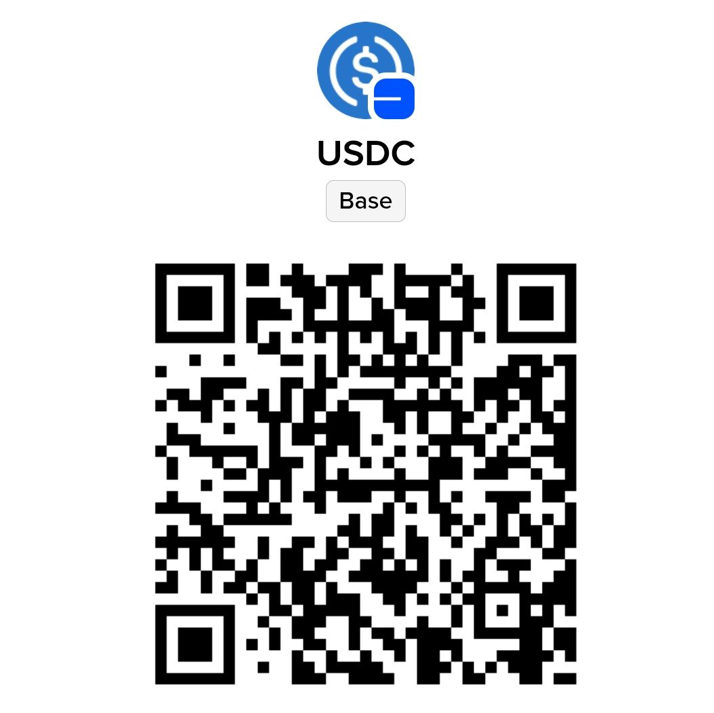

# 使用教程

> 本教程面向软件最新版本；旧版本的界面和功能可能有所不同。

> 交流反馈：QQ 频道 [MT阅读器](https://pd.qq.com/s/8yqstquyx?b=9)、QQ 群 **1080302768**、[Discord](https://discord.gg/qxfC2kqfr)

---

按使用深度阅读：[基础：快速上手](#基础快速上手) → [进阶：效果与日常管理](#进阶效果与日常管理) → [高级：请求与提示词](#高级请求与提示词)。首次使用完成基础部分即可开始阅读。

## 基础：快速上手

### 1. 导入漫画

在漫画库页面操作：

- 点击右下角 **＋** 创建文件夹，进入后添加漫画图片
- 点击 **「从漫画文件夹导入」** 直接导入整个文件夹
  - 若目录下有多章子文件夹，会自动创建合集并导入为子章节
  - 若目录直接包含图片，按单本漫画导入
- 点击 **「从 CBZ/ZIP/PDF 导入」** 可多选压缩包或 PDF，软件会按选择顺序逐个导入；单个文件失败后继续下一个，导入时会显示进度提示
- **图片文件名需与阅读顺序一致**（如 `1.jpg`, `2.jpg`），否则页码会乱

### 2. 配置 API

软件需自备 API。如果还没有，先看：[API 获取指南](./API获取指南.md)。

> 提示：目标语言由软件界面语言决定。简体中文、繁体中文、英文、巴西葡萄牙语、俄文界面分别翻译为对应语言。

在设置页填写：

1. **API 格式** —— 按服务商接口选择「OpenAI 兼容」「OpenAI Responses」或「Gemini」
2. **API 地址** —— OpenAI 兼容接口填写服务商给出的上级地址即可，例如 `https://api.deepseek.com/v1`、`https://open.bigmodel.cn/api/paas/v4`；软件会自动补全 `/chat/completions`。OpenAI Responses 会补全 `/responses`；已填写完整端点时不会重复补全。两种 OpenAI 格式的「获取模型列表」会补全 `/models`
3. **API Key** —— 妥善保管，勿泄露
4. **模型名称** —— 须与供应商提供的完全一致，可直接从官网复制或点击「获取模型列表」选择

填写完成即返回漫画库。

### 3. 翻译

第一次使用建议先关闭「全文速译」和「VL 整页直译」，保持本地 OCR，先翻译少量页面确认 API 可用；俄语请使用 API OCR 或 VL，配置方法见进阶部分。

1. 在文件夹内设置源语言并点击 **「翻译」**（支持日/英/韩/法/西/葡/德/意/俄/中文等）；合集也可整体翻译
2. 等待翻译完成，或预处理结束后点击 **「开始阅读」** 边翻边看
3. 后台翻译完成后会发送带声音的高优先级通知，点击通知可回到漫画库查看结果

> 软件会自动判断作品是否更接近条漫并切换为「条漫滚动」；如需手动调整，可在文件夹的「阅读设置」中修改。

### 4. 阅读与调整

**普通气泡**指软件检测到的漫画对白气泡区域，译文在气泡轮廓内排版；**游离气泡**指气泡外独立文字区域（如旁白、招牌）的译文框，以检测到的文字区域为基础排版。手动新建的框仍按普通气泡的大小规则处理。

- **调整字号**：在设置 →「普通气泡框设置」中，分别调整「普通气泡文字填充比例」和「游离气泡文字填充比例」。范围为 **20%–100%**，默认 **100%**，表示使用根据文字量和可用空间自动适配的字号；降低比例可缩小文字，提高比例可放大文字，最高恢复到自动适配字号。例如 80% 表示使用自动字号的 80%。此设置只调整文字大小，不改变气泡大小，横排、竖排、阅读和导出均生效；手动新建的框使用普通气泡的文字填充比例。
- **避免遮盖原气泡边缘**：「气泡回缩」用于缩小渲染气泡的覆盖范围，避免盖住漫画原本的气泡边缘或附近画面；按实际遮盖情况小幅调整即可。游离气泡的大小设置用于调整其覆盖范围，正数扩大、负数缩小。调整字号请使用对应的文字填充比例。
- **拖动气泡** 可调整位置，软件会自动保存
- **双击图片** 进入/退出放大模式；进入放大后可使用 **取消键** 或 **加减号** 微调气泡
- **切换页面**：在漫画库文件夹中点击对应图片文件名即可跳转
- **单页或多页重译**：回到漫画库，长按图片进入多选，选中需要重译的页，再点击「重译」。全部重译可先「全选」，无需删除漫画
- **补缺文字区域**：右上角编辑按钮 → 加号新建空白气泡 → 拖到文字区域 → 绿勾退出；条漫模式下允许跨页创建气泡

> 已保存的译文会直接读取；更换语言、模型、文风或提示词不会自动重译。需要替换已有译文时，请主动选择页面并点击「重译」。

---

## 进阶：效果与日常管理

### 翻译方案的费用与效果

| 方案 | 请求内容与开支 | 效果与适用情况 |
| --- | --- | --- |
| 普通翻译：本地 OCR，关闭补充 | 本地识别后只发送文字，通常最省钱 | 适合字迹清晰、排版规整和内容简单的漫画；本地识别错字或漏字会影响译文 |
| 普通翻译 + AI OCR 补充 | 将低置信度、识别不完整、为空或失败的待补充区域按页汇总，以白底蒙版和 ID 标注批量识别，长图按检测分块请求，再进行文字翻译；费用取决于触发补充的页数、分块数和模型定价 | 在省钱与识别、翻译质量间取得平衡；不能保证发现所有识别错误 |
| 全文速译 + API OCR | 先按窗口完成 API OCR、译名提取和翻译；请求次数与图片识别费用较高 | 通常综合翻译质量最高的方案。API OCR 能减少本地识别错误，全文速译会统一前后人名、地名等译名；适合对成品质量要求最高的场景 |
| VL 整页直译 | 将标注后的页面或长图分块发给主视觉模型，跳过 OCR，通常比本地 OCR + 文字翻译更贵 | 理论上最快的方案，实际速度取决于所选 API 的响应速度、并发能力和图片处理速度；仍受检测范围和模型能力影响 |
| VL 整页直译 + 适度合并 | 一次发送多页及其分块，单次图片用量和费用更高，整体仍属于高预算方案 | 可减少请求次数并让模型参考相邻页对白，但实际速度仍取决于 API；合并过多可能漏译或降低质量 |

#### 推荐起点

- **最省钱**：关闭全文速译和 VL 整页直译，使用本地 OCR，关闭 AI OCR 补充，主 API 选择便宜且翻译能力够用的文字模型。作品译名较少时也可关闭「译名处理」；已有译名仍会作为参考。
- **费用与质量均衡**：保留本地 OCR，将 AI OCR 补充从「低级」开始尝试，识别仍不理想再升到「中级」。OCR API 单独选择廉价、支持图片输入且擅长源语言识别的模型；主 API 继续负责翻译，不必让每次补充识别都使用昂贵主模型。
- **最高质量**：通常建议开启全文速译并关闭本地 OCR，改用质量较强的 API OCR，同时使用能力较强的主翻译模型。这样能兼顾 OCR 准确度和全文译名一致性，但请求次数与费用都会增加。
- **理论最快**：开启 VL 整页直译，使用响应速度快、并发能力强的视觉模型；实际速度取决于 API 服务商和网络状况，图片开支通常也更大。

全文速译会在每个处理窗口内提取和累计译名，并生成最多 6000 字符的剧情概览供后续窗口参考。概览通过 SynopsisStore 保存为文件夹内按目标语言区分的 synopsis.json，续译时读取并继续更新，不影响已保存译文。如果出现模型拒绝翻译的情况,请关闭这个选项。

#### OCR 补充的请求方式与计费

漫画库的 AI OCR 补充按页汇总待补充区域，使用白底蒙版和 ID 标注进行批量识别，**不会按每个气泡分别请求**。普通单块页面中的多个待补充区域可在一次请求中识别；长图按实际检测分块发送，因此一页可能产生多次请求。

按次收费或按用量收费的模型都可以选择，应结合触发补充的页数、长图分块数、单次价格及图片输入价格比较。中、高级会复核更多区域，可能增加触发补充的页面、分块和图片用量，但不能把区域数直接当作请求次数。OCR API 目前只支持 OpenAI 兼容 chat 接口，模型必须支持图片输入和源语言识别。

#### 合并页数翻译

- 适度合并有助于模型理解前后对白、统一称呼，也能减少请求次数及重复发送的提示词。按次收费的**翻译 API**可能因此省钱，但 OCR/API OCR 补充的请求数不受此设置影响。
- 设置范围为 1–500 页，1 表示不合并。普通文字请求按实际请求预算拆分，VL 每次最多合并 50 页；设置更大时按 50 页处理。建议从 5～15 页开始，VL、长图或文字密集页宜从更小的批次尝试。过大的请求可能增加手机负担、触发服务端限制或降低译文质量。
- 合并页数控制单次 AI 请求包含的页面数，不限制整章可翻译页数。软件会按可用内存和当前合并页数自动安排处理窗口，条漫窗口还会保留相邻页衔接。

> 漏检的文字区域可手动画框补充翻译。

### 阅读外观与翻译文风

- **全文速译太慢**：关闭「全文速译」即可改用逐页并发翻译
- **气泡太挡画面**：在设置的「普通气泡框设置」中调整普通气泡或游离气泡的不透明度；如果覆盖了原气泡边缘，可小幅增加「气泡回缩」。悬浮窗气泡在「悬浮窗气泡设置」中单独调整
- **游离气泡文字色**：游离气泡会根据背景自适应文字颜色
- **翻译文风不佳**：在设置中调整全局翻译文风，或在文件夹内设置专属文风；合集内章节共用合集文风。「跟随全局文风」关闭后留空表示不附加文风要求
- **自定义字体**：在设置页的「字体设置」中可上传字体文件并开启加粗，普通气泡框与悬浮窗气泡框共用同一套字体

### 文件夹翻译选项

- **VL 整页直译**：在文件夹内开启，使用支持图像输入的主模型翻译标注后的页面内容，跳过 OCR；长图按分块处理。它与「全文速译」不能同时开启。
- **全文速译**：软件按内存自动安排处理窗口，在窗口内依次完成 OCR、译名提取和翻译，并逐批累计译名；窗口大小不代表整章页数上限。首批需要先完成译名提取。条漫滚动模式会处理跨页气泡衔接，普通阅读不会合并跨页气泡。全文速译还会生成可保存并在续译中更新的剧情概览，帮助后续窗口参考前情，不会写入已保存译文。
- **译名处理**：普通翻译及 VL 整页直译可按需开启，开启后提取并补充新译名，已有译名优先复用，避免同一名称在后续页面反复改译；关闭后仍会参考已有译名，但不新增译名。全文速译固定启用译名处理。
- **VL 完整画面**：用于漫画库的 VL 整页直译。开启时保留完整画面并标注 ID，让模型结合人物、动作和场景理解对白；关闭时仅保留气泡和文字区域，其余填白。长图仍按检测分块发送。此选项与下方「仅翻译气泡」用途不同；悬浮窗和 API OCR 仍使用白底蒙版。
- **仅翻译气泡**：按文件夹保存，开启后本地 OCR 只识别检测到的气泡区域；整页未检测到气泡时，仍会识别页面文字。启用 VL 整页直译或关闭本地 OCR、改用 API OCR 时，此项置灰，原设置仍保留。适合不想翻译气泡外文字的作品，也可能略过旁白或招牌。

条漫滚动模式下，如果相邻两页在接缝附近都有检测区域，软件会先对接缝附近重新检测，以修复被分页截断的气泡，再进行跨页合并。普通横向阅读不执行这项跨页修复或合并。

### OCR 设置

在设置页点击「OCR 设置」：

- **开启本地 OCR**：使用内置引擎离线识别文字，后续 AI 翻译仍需联网；俄语需关闭本地 OCR 并配置 OCR API，或改用 VL 整页直译
- **AI OCR 补充模式**：开启本地 OCR 时，可按低/中/高级强度筛选识别不佳的区域，在漫画库中按页汇总后交给 API 批量识别；关闭补充只用本地识别，中、高级会增加请求。费用与模型选择见上方说明
- **关闭本地 OCR**：全部使用在线 API OCR，需有可用的 OCR API 地址/Key/模型；每个字段留空时分别复用主 API 的对应配置
- API OCR 只支持 OpenAI 兼容 chat 接口，需使用支持图片输入及源语言识别的模型
- **手动框选气泡默认使用 API OCR**：独立于补充模式的开关，阅读页与悬浮窗共用；即使关闭补充，开启此项后手动补框仍会产生 OCR API 请求
- OCR 超时可调高「OCR API 超时（秒）」范围 30–1200

### 悬浮窗翻译

在漫画库页点击 **「悬浮窗翻译」**，按提示授予悬浮窗和屏幕捕获权限，并在启动时选择本次使用的翻译语言。悬浮球默认手势如下，可在「悬浮窗翻译设置」中为单击、双击、长按和三击重新指定操作：

| 操作 | 效果 |
|------|------|
| 单击悬浮球 | 识别并翻译当前屏幕文本 |
| 双击悬浮球 | 清除所有气泡 |
| 长按悬浮球 | 弹出菜单 |

长按菜单选项：

- **编辑模式**：悬浮层拦截触摸，可拖移气泡、长按删除、点击「新增气泡」后框选区域手动补框。确认后自动补翻新增气泡。
- **划屏翻译**：不自动检测，直接进入编辑模式由用户框选。
- **翻译检测区域**：在屏幕上框选翻译范围并确认，下次翻译生效；也可恢复全屏。
- **退出**：关闭悬浮窗。

编辑结果仅限当前会话，再次识别或退出后重置。遇到空画面或受截屏限制的应用时，软件会停止本次识别并提示；其他无识别结果的情况可检查屏幕捕获授权和 API 配置。

#### 悬浮窗翻译设置

独立配置悬浮窗专用 API 地址/Key/模型，留空时回退主设置。

- **VL 整页直译**：将标注了气泡和文字区域的整页图交给支持图像输入的模型翻译，跳过 OCR；长图按分块发送。可设置 VL 翻译线程数。
- 漫画库的「每次请求合并页数」不用于悬浮窗；悬浮窗暂不处理译名。未开启 VL 时，沿用 OCR 设置及补充识别策略，OCR API 使用「OCR 设置」中的配置。
- **校对模式**：每次识别后自动进入编辑模式。
- **自动清除气泡**：翻页时自动关闭气泡。
- **悬浮球手势**：可调整单击、双击、长按和三击的操作。
- **气泡显示方式**（Android 12 及以上）：「半透明」时气泡最高 80% 不透明，触摸可穿透到下方应用；「不透明」时气泡完全不透明，但显示期间会拦截屏幕触摸、冻结画面，此时在屏幕上按悬浮球手势的设置操作，例如双击清除屏幕。

不透明模式至少需要将一个悬浮球手势设为「清除气泡」，否则设置无法保存。气泡显示时屏幕手势会按悬浮球的单击、双击、长按或三击配置执行；目前只有「清除气泡」会在不透明画面上执行。没有气泡或正在编辑时，屏幕触摸仍按当前界面状态处理；Android 12 以下不拦截下层应用触摸。

悬浮窗译文的字号在设置 →「悬浮窗气泡设置」→「悬浮窗气泡文字填充比例」中单独调整，范围同样为 **20%–100%**，默认 **100%**。降低比例可缩小文字，提高比例可恢复至自动适配字号，不改变气泡大小；此设置只作用于悬浮窗，不影响漫画库阅读和导出。

### 漫画库管理、导出与备份

- **批量翻译**：长按漫画或章节文件夹进入多选，使用底部操作栏的「翻译」；合集内可选择单个或多个章节翻译。底部还可全选、取消选择及删除，图标按钮可长按查看提示。
- **章节重命名**：合集内子文件夹右侧的三点菜单提供重命名操作。
- **继续未完成任务**：应用进程被终止或重启后，不会自动续跑，需手动重新发起翻译；软件会利用已保存的 OCR 和译文跳过已完成页面。
- **导出漫画**：文件夹内支持导出 CBZ、PDF 或纯图片，默认路径为文档目录下的 `manga-translate`。
- **清除悬浮窗缓存**：清除应用缓存可移除悬浮窗翻译缓存；漫画库中已保存的逐页译文不会因此删除或自动重译。需要替换译文时使用「重译」。
- **备份漫画与设置**：设置页的「导出漫画与设置」可创建备份包，需要恢复时使用「导入漫画与设置」。
- **合集内导入子章节**：进入合集后点击「导入子章节」，支持多选勾选或单个导入，同名/空目录自动跳过。

---

## 高级：请求与提示词

### AI 请求设置

「AI API 调用并发数」范围为 **1–100**，表示同时发起的 AI 请求上限。先用较小数值，确认服务商限流和手机负载后再提高；提高并发不保证更快，遇到限流应降低。

「每次请求合并页数」可设为 1–500，1 表示不合并，建议从 5～15 页尝试。文件夹、合集和批量任务中的普通翻译、全文速译及 VL 整页直译均支持合并，结果仍逐页保存；VL 每次最多发送 50 页，设置超过 50 时按 50 页处理。软件根据内存和合并页数自动安排处理窗口，窗口大小不限制整章总页数。页数不是越大越好，费用与质量的取舍见上方说明。

### 模型上下文与文本请求预算

设置页的「模型上下文配置」用于填写当前供应商、API 地址、接口格式和模型的能力上限，单位为 token：最大输入、最大输出和总上下文。切换供应商或模型后会读取对应配置，不会把其他模型的能力套用过来。

不确定模型规格时可以留空，应用会显示并使用保守默认值：最大输入 262,144、最大输出 65,536、总上下文 262,144 token。默认值不是服务商对当前部署的能力保证；本地部署或服务商限制更小时，请按实际规格填写。输入和输出上限彼此独立，实际请求还需为提示词、正文、输出和安全余量共同预留总上下文。

模型能力上限与「LLM 参数」里的单次请求输出上限是不同设置。文本请求预算会结合提示词、译名等完整输入以及输出预留检查并按完整页面拆分批次；过大的不可拆页面或固定提示词无法容纳时，请降低合并页数、精简提示词或改用上下文更大的模型。模型上下文配置不会改变已保存译文，也不会自动重译页面。

### 自定义请求参数

参数作用于主供应商，参数键不可重复。

### 自定义提示词

在设置页打开「自定义提示词」。只想调整语气和表达时，优先使用全局或文件夹文风；需要修改模型指令时再编辑提示词。

1. 选择模式：普通翻译、全文速译、译名提取、悬浮翻译、VL 完整画面、VL 气泡蒙版或 OCR 识别。仅修改**当前界面语言、当前模式**的提示词；切换界面语言后需分别配置。
2. 建议先点「导出 JSON」保留模板，再直接编辑或用「导入 JSON」载入文件。导入只是预览，切换模式会保留草稿。
3. 点击「保存当前模式」才会生效；每个模式需分别保存。要撤销已保存的自定义内容，点击「恢复当前模式内置提示词」并确认，当前模式立即恢复内置内容。

文件须为不超过 **256 KiB** 的标准 UTF-8 JSON。字段与类型须符合当前模式的内置模板，不能有重复键、额外字段或 `//`、`/* */` 注释。导出文件中的 `_说明` 可保留，用于解释格式，不会发送给模型。

- 保留模板中的 `system_prompt`、`user_prompt_prefix`、`example_messages` 等字段；OCR 模式还需要 `batch_prompt`。文字字段须非空；示例消息使用 `role` / `content`，角色仅限 `system`、`user`、`assistant`。
- 保留模板要求的 `{{STYLE_HINT}}` 文风占位符和 `<image>` 标记。
- 保持内置输入输出协议：结构化翻译返回 `items[{id,translation}]`，每个请求 ID 恰好出现一次；不能把 `text` 当译文，空译文表示过滤该区域。译名沿用 `glossary_used` 协议；OCR 单区域返回原文或 `None`，批量 OCR 按 ID 返回 `items`。

格式校验通过不代表指令含义正确。先在少量页面验证结果；提示词修改只影响后续请求，已有译文不会自动重译。

---

## 赞赏码

如果这款软件帮你更轻松地阅读了喜欢的漫画，欢迎自愿赞赏，支持后续开发与维护。感谢每一份支持，也欢迎通过上方的交流渠道反馈问题和建议。

USDC（Base 网络）：

